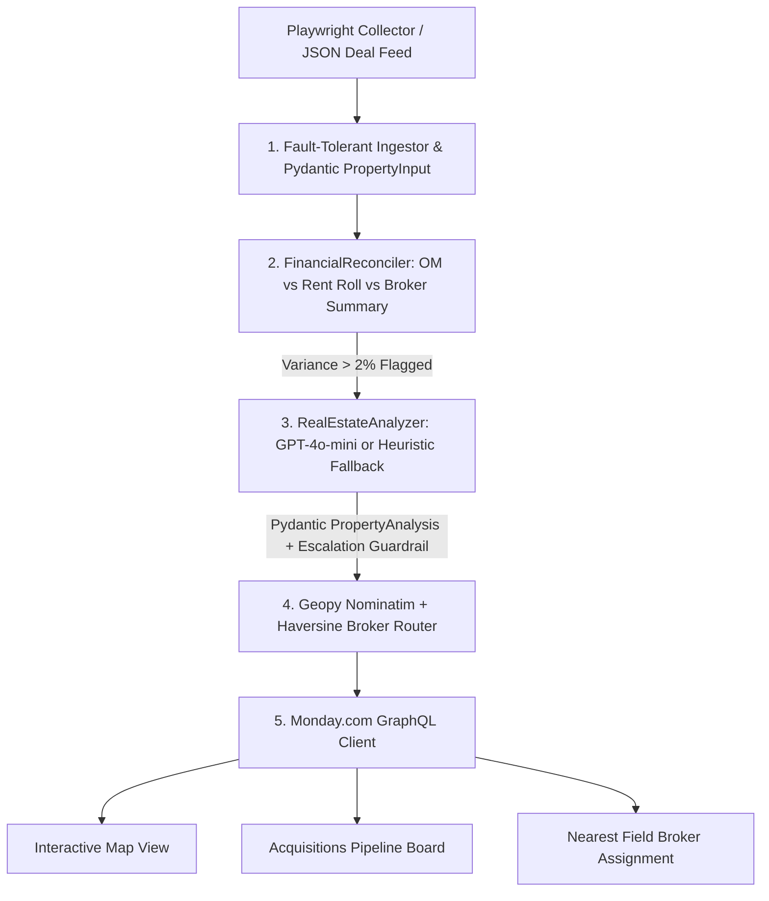

# AI Real Estate Pipeline — Automated Underwriting, Document Reconciliation & GIS Dispatch

[](https://github.com/jraphaelcunha/ai-real-estate-pipeline)


> **[ Ler em Português ](README.pt-br.md)**

> **Executive Overview:** The **AI Real Estate Pipeline** is a modular property screening, cross-document financial reconciliation, and GIS routing engine designed for real estate acquisitions teams and brokerage operations. It ingests unstructured property listings and multi-document deal feeds, enforces strict **Pydantic v2** data contracts, cross-checks financial values across **Offering Memorandums, Rent Rolls, and Broker Summaries** with page-level provenance, computes deterministic underwriting reserves, geocodes assets via **Geopy Nominatim**, and routes qualified opportunities to the nearest field broker on **Monday.com Enterprise Work OS** via GraphQL.

For a detailed breakdown of architectural decisions and failure-mode trade-offs, see [docs/ARCHITECTURE.md](docs/ARCHITECTURE.md).

---

## Intellectual Property & Data Sanitization Governance

> [!NOTE]
> **Sanitized Reference Architecture (NDA Compliant):**
> This public repository is an anonymized, open-source reference architecture extracted from production consulting workflows. All client-proprietary business rules, production credentials, custom prompts, and real deal documents remain strictly confidential under NDA. All bundled fixtures (`data/raw_mock_data.json`, `eval/dataset/underwriting_v1.jsonl`) and RFC-2606 links (`*.example`) are synthetic datasets created strictly for architectural verification and deterministic CI testing.

---

## Commercial Value: Deal Screening, Conflict Detection & GIS Routing

* **Automated Deal Intake:** Eliminates manual copy-paste sorting across scattered listing portals and investment flyers (`PlaywrightListingCollector` + `JsonFileIngestor` with per-item `ValidationError` fault isolation).
* **Cross-Document Financial Reconciliation:** `FinancialReconciler` compares asking price, annual NOI, and unit counts across **Offering Memorandums**, **Rent Rolls**, and **Broker Summaries** (recording exact document & page provenance). Any variance above tolerance (default 2%) automatically flags the deal and escalates its Monday.com status to **`AI Reviewing` (`INVESTIGATE`)** so analysts review conflicting numbers side by side before underwriting.
* **Deterministic Guardrails & Graceful Degradation:** LLM extraction (`gpt-4o-mini`, `temperature=0`, `.with_structured_output(LLMUnderwritingOutput)`) is strictly isolated from deterministic financial calculations and bounded by Pydantic v2 `PropertyAnalysis` validators. If external APIs experience `RateLimitError` (429) or timeouts, the analyzer seamlessly transitions to a deterministic heuristic underwriting engine (`_compute_heuristic_underwriting`) so batch runs never stall.
* **GIS Mapping & Nearest-Broker Dispatch:** Addresses are geocoded via Geopy Nominatim (with metro centroid fallbacks) and routed to the nearest active field broker using the **Haversine distance formula**, updating the Monday.com Map View and Acquisitions Board via GraphQL.

---

## 1. System Architecture & Data Flow



---

## 2. Automated Testing, Security & Evaluation Harness

The test suite and evaluation harness run with deterministic offline fixtures (zero external API keys or token spend required):

```bash
# Run unit test suite with coverage
pytest tests/ -v --cov=src --cov-report=term-missing

# Run strict Ruff linter & Bandit security scan
ruff check src/ tests/ eval/
bandit -r src/

# Run deterministic underwriting & conflict reconciliation eval (--mock)
python eval/evaluate.py --dataset eval/dataset/underwriting_v1.jsonl --mock
```

See [eval/README.md](eval/README.md) for details on offline verification vs. live OpenAI benchmarking.

---

## 3. Quickstart & Local Execution

### Prerequisites
* Python 3.11+
* OpenAI API Key *(optional — defaults to deterministic heuristic underwriting mode when unset)*
* Monday.com API Key *(optional — defaults to GraphQL dry-run logging mode when unset)*

### Setup & Run
```bash
git clone https://github.com/jraphaelcunha/ai-real-estate-pipeline.git
cd ai-real-estate-pipeline

python -m venv venv
source venv/bin/activate  # On Windows: venv\Scripts\activate

pip install -r requirements.txt
python -m src.main
```

---

## 4. Limitations and Next Steps

* **Document OCR & Table Extraction:** The current reference ingestor accepts pre-parsed JSON/scraped listing feeds with page provenance; handling raw multi-page PDF Rent Rolls directly would require adding a PDF table extraction / Vision OCR stage ahead of `FinancialReconciler`.
* **Asynchronous Queues & Idempotency Keys:** Converting the synchronous batch loop in `src/main.py` to an event queue (e.g., SQS or Redis/RQ) with external deal-ID deduplication would prevent duplicate Monday.com items under high-volume concurrent ingestion.
* **Submarket CapEx Calibration:** Heuristic renovation multipliers provide resilient fallback coverage during LLM rate limits, whereas production deployments should calibrate cost-per-sqft baselines against live regional contractor comps.

---

## 5. Canonical Repository Structure

```text
ai-real-estate-pipeline/
├── .github/
│   └── workflows/
│       └── ci.yml                     # CI Quality Gate (Ruff + Bandit + Pytest + Eval)
├── data/
│   └── raw_mock_data.json             # Sanitized synthetic deal package fixtures
├── docs/
│   ├── ARCHITECTURE.md                # Architectural decisions & trade-offs
│   └── monday_configuration_guide.md  # Monday.com Map & Board BI setup guide
├── eval/
│   ├── README.md                      # Offline & live evaluation guide
│   ├── evaluate.py                    # Action & conflict detection benchmark harness
│   └── dataset/
│       └── underwriting_v1.jsonl      # 10-case synthetic underwriting fixture dataset
├── src/
│   ├── config.py                      # Pydantic Settings configuration
│   ├── main.py                        # Pipeline entrypoint
│   ├── domain/
│   │   └── schemas.py                 # Pydantic v2 contracts & safety validators
│   ├── services/
│   │   ├── interfaces.py              # Abstract DataIngestor interface
│   │   ├── ingestor.py                # Fault-tolerant JSON feed ingestor
│   │   ├── scraper.py                 # Modular Playwright Chromium collector
│   │   ├── reconciler.py              # Multi-document financial conflict detector
│   │   ├── analyzer.py                # LLM underwriter & heuristic fallback engine
│   │   └── monday.py                  # Monday.com GraphQL client + GIS dispatch
│   └── utils/
│       ├── geocoder.py                # Geopy Nominatim & Haversine broker routing
│       ├── get_column_ids.py          # Monday.com board column discovery helper
│       └── logger.py                  # Standardized console logger
├── tests/
│   ├── conftest.py                    # Shared Pytest fixtures
│   └── unit/                          # Deterministic unit test suite
├── LICENSE                            # MIT License
├── pyproject.toml                     # Ruff, Pytest, and Coverage settings
├── requirements.txt                   # Core dependencies
└── requirements-dev.txt               # Testing, lint, and security dependencies
```

---

## License

Distributed under the MIT License. See [LICENSE](LICENSE) for more information.
