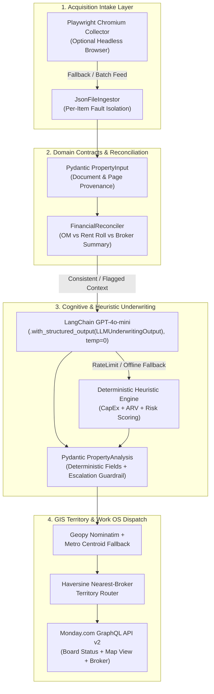

# System Architecture & Technical Design Decisions

This document details the engineering architecture, cross-document reconciliation contracts, deterministic fallbacks, and geospatial routing trade-offs governing `ai-real-estate-pipeline`.

---

## 1. System Topology & Data Flow

---

## 2. Key Architectural Decisions & Trade-Offs

### Decision 1: Cross-Document Reconciliation Outside the LLM (`FinancialReconciler` + Pydantic `@model_validator`)

* **Context:** Real estate deal packages routinely combine Offering Memorandums (OMs), Rent Rolls, and Broker Summaries where Net Operating Income (NOI), asking prices, or unit counts conflict across documents. Relying solely on an LLM prompt to notice arithmetic discrepancies across documents risks silent hallucinations or overly optimistic `BUY` ratings.
* **Chosen Architecture:**
  1. **Source Provenance Schema:** `DocumentSourceMetric` records `document_type` (`offering_memorandum`, `rent_roll`, `broker_summary`, `listing_portal`) and `page_number` alongside extracted numeric metrics (`Decimal`).
  2. **Deterministic Variance Check:** `FinancialReconciler.reconcile_documents()` computes exact percentage variance across sources against a configurable threshold (default `2.0%`).
  3. **Hard Escalation Validator:** `PropertyAnalysis.enforce_risk_and_reconciliation_guardrails` executes as a Pydantic v2 `@model_validator(mode="after")`. Whenever `reconciliation.is_consistent` is `False` (or critical environmental/structural/zoning risks are flagged), any `BUY` decision is automatically overridden to `ActionEnum.INVESTIGATE` (`AI Reviewing` on Monday.com) and `viability_score` is capped at `68`.

---

### Decision 2: Deterministic Heuristic Graceful Degradation vs. Failing Batch Runs

* **Context:** External LLM endpoints experience transient `RateLimitError` (HTTP 429), timeouts, or credential absence in offline CI environments.
* **Chosen Architecture:**
  * `RealEstateAnalyzer` attempts structured LLM underwriting (`temperature=0`, `timeout=15`, `max_retries=2`) when `OPENAI_API_KEY` is configured.
  * On API errors or missing credentials, the analyzer degrades cleanly to `_compute_heuristic_underwriting()`, computing normalized price/sqft, parametric renovation reserves from physical/legal/environmental risk markers (`foundation`, `flood zone`, `mold`, `eviction`, `zoning`, `contamination`), ARV projections, and deterministic action tiers.
* **Trade-Off:** Heuristic scores do not replace deep qualitative underwriting of nuanced prose, but ensure 100% deterministic CI verification and uninterrupted batch screening when upstream LLM providers throttle requests.

---

### Decision 3: Per-Item Fault Isolation in Batch Ingestion (`JsonFileIngestor`)

* **Context:** A 50-to-80 deal batch frequently contains partially malformed portal scrapes or missing required fields.
* **Chosen Architecture:** `JsonFileIngestor.load_properties()` validates each dictionary independently inside a `try/except ValidationError` boundary. Invalid items emit structured warning logs and are skipped while valid deals continue downstream.

---

### Decision 4: Geopy Nominatim with Metro Centroid Fallback & Haversine Broker Dispatch

* **Context:** OpenStreetMap Nominatim enforces strict request rate limits (`1 req/sec`) and can time out during batch bursts.
* **Chosen Architecture:** `src/utils/geocoder.py` executes Nominatim lookups with an explicit 5-second timeout and falls back to U.S. metro centroid coordinates on `GeocoderTimedOut` or `GeocoderServiceError`. Once coordinates are resolved, `assign_nearest_broker()` ranks active regional brokers using the **Haversine great-circle distance formula**, routing the deal to the closest local broker on Monday.com.

---

### Decision 5: Synchronous GraphQL Integration with Explicit Timeouts

* **Context:** Unbounded HTTP calls in batch loops can hang worker processes indefinitely on dead sockets.
* **Chosen Architecture:** `MondayClient.create_item()` enforces `timeout=10` on GraphQL POST requests, validates GraphQL `errors` payloads explicitly, and automatically runs in safe dry-run logging mode when `MONDAY_API_KEY` is unset.
